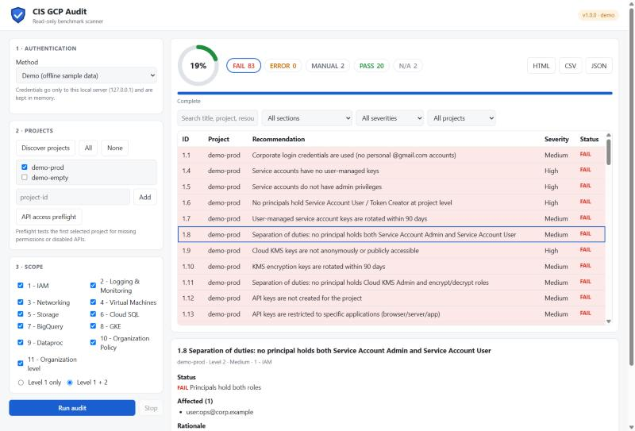
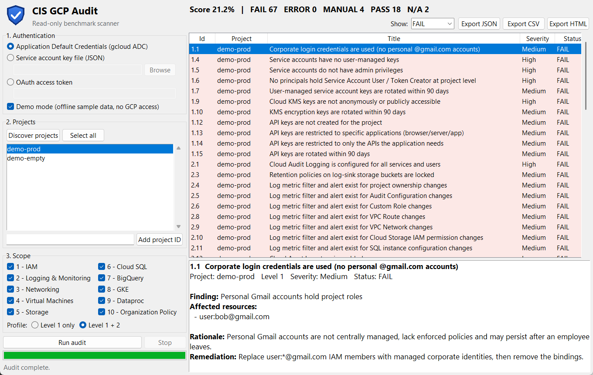

<p align="center">
  
</p>

<h1 align="center">CIS GCP Audit Tool</h1>

<p align="center">
  <a href="https://github.com/3tternp/cis-GCP-Audit/actions/workflows/ci.yml"></a>
  
  
  
  
</p>

<p align="center">
  A <b>read-only</b> Python tool that audits Google Cloud projects <i>and their organization</i> against the
  <b>CIS Google Cloud Platform Foundation Benchmark</b>, from a desktop window, a browser UI or the command line.<br>
  It calls the GCP REST APIs directly and never changes anything.
</p>

<p align="center">
  <br>
  <sub>Browser UI (<code>--web</code>) · demo data</sub>
</p>

## ✨ Features

- 🌐 **Browser UI** served from your own machine (localhost only), plus a **desktop GUI** (Tkinter) and a headless **CLI**
- 🔐 **Three sign-in options**: Application Default Credentials, service account key, or access token
- 🔎 **Project discovery**: list every project your credential can see, or add IDs manually
- 🧪 **107 checks** across 11 sections, each with rationale and remediation
- 🏢 **Organization aware**: audits the org itself, and counts audit config / log sinks inherited from folders and the org
- 🩺 **API access preflight**: finds missing permissions and disabled APIs *before* you run a long audit
- 📊 **Compliance score**, filters (status, section, severity, project, free text), sortable table
- 📤 **Export** to HTML, CSV or JSON
- 🎭 **Demo mode**: try everything offline with sample data, no GCP account needed
- ✅ **Tested**: 41 unit tests (including the web server's security guards) run in CI on Windows and Linux

## 🚀 Quick start

```powershell
pip install -r requirements.txt
python -m gcp_cis_audit --web      # browser UI at http://127.0.0.1:8765/
python -m gcp_cis_audit            # desktop GUI
```

| I want to... | Do this |
|---|---|
| 🌐 Use the browser UI | `python -m gcp_cis_audit --web` (or double-click `run_web.bat`) |
| 🖱️ Use the desktop window | `python -m gcp_cis_audit` (or double-click `run_gui.pyw`) |
| 🎭 Try it with sample data | add `--demo`, or double-click `run_gui_demo.pyw` |
| 🩺 Check my permissions first | `python -m gcp_cis_audit --cli -p my-project --preflight` (or the **API access preflight** button) |
| ⌨️ Run headless / in a pipeline | `python -m gcp_cis_audit --cli -p my-project --html report.html` |
| 🧪 Run the tests | `python -m unittest discover -s tests` |

The CLI exits with code `1` when any check fails, so it can gate a pipeline.

### 🔒 Web UI security

The web UI is meant for your own machine, and is hardened accordingly:

- binds to `127.0.0.1` only (there is deliberately no option to expose it on the network)
- rejects any request whose `Host` header isn't this exact local address (blocks DNS-rebinding)
- every API call needs a random per-run token; cross-origin POSTs are refused
- strict Content-Security-Policy; all result text is rendered as plain text, never as HTML
- credentials are kept in memory for the run and never written to disk

## 🔑 Authentication

| Method | How |
|---|---|
| 🪪 Application Default Credentials | `gcloud auth application-default login` |
| 🗝️ Service account key | Pick the JSON key file (or `--key-file`) |
| 🎟️ Access token | Paste the output of `gcloud auth print-access-token` |

Grant the identity read-only roles: `roles/viewer`, `roles/iam.securityReviewer`, `roles/cloudkms.viewer`,
`roles/logging.viewer`, `roles/monitoring.viewer`, `roles/serviceusage.serviceUsageViewer`, plus
`roles/container.viewer`, `roles/dataproc.viewer`, `roles/cloudsql.viewer`, `roles/serviceusage.apiKeysViewer`,
`roles/orgpolicy.policyViewer`. For organization-level checks and inherited audit config also grant, on the
organization: `roles/iam.securityReviewer`, `roles/resourcemanager.organizationViewer`,
`roles/essentialcontacts.viewer`, `roles/logging.viewer` and `roles/orgpolicy.policyViewer`.
Run the **preflight** to see exactly which APIs are reachable. Disabled APIs show as **N/A**; missing permissions as **ERROR**.

## 📋 Coverage (107 checks)

| | Section | Checks |
|---|---|---|
| 👤 | **1 IAM** | 1.1 1.4 1.5 1.6 1.7 1.8 1.9 1.10 1.11, API keys 1.12-1.15 (+ manual 1.2 1.3) |
| 📜 | **2 Logging & Monitoring** | 2.1 2.2 2.3, 2.4-2.11 (metric filter **and** alert), 2.12 DNS logging, 2.13, 2.16 LB logging |
| 🌐 | **3 Networking** | 3.1-3.9 (default/legacy networks, DNSSEC, SSH/RDP exposure, flow logs, TLS/SSL policies) |
| 💻 | **4 Virtual Machines** | 4.1-4.9, 4.11 (incl. CSEK disks, Confidential VM) |
| 🪣 | **5 Storage** | 5.1 5.2 |
| 🗄️ | **6 Cloud SQL** | 6.4-6.7, MySQL flags 6.1.x, PostgreSQL flags 6.2.x, SQL Server flags 6.3.x |
| 📈 | **7 BigQuery** | 7.1 7.2 7.3 |
| ☸️ | **8 GKE** | 8.1-8.13 |
| ⚙️ | **9 Dataproc** | 9.1-9.2 |
| 🏛️ | **10 Organization Policy** | 10.1-10.12 (effective org-policy constraints on the project) |
| 🏢 | **11 Organization level** | 11.1-11.9: org IAM hygiene, separation of duties, org audit logging, aggregated sink, Essential Contacts, domain-restricted sharing |

**How hierarchy works:** project-scope checks run per project. Section 11 runs once per organization discovered
from the selected projects' ancestry. Checks 1.8, 1.11, 2.1 and 2.2 also consider policies and aggregated sinks
inherited from folders and the organization. If an ancestor can't be read with your credentials, the finding says
"Not evaluated: ..." instead of silently passing or failing.

## 🚦 Result statuses

| Status | Meaning |
|---|---|
| 🟢 **PASS** | Compliant |
| 🔴 **FAIL** | Non-compliant; affected resources and remediation are shown |
| 🟠 **ERROR** | The check could not run (usually missing permission) |
| ⚪ **MANUAL** | Cannot be assessed through the API; verify by hand |
| ⚫ **N/A** | Nothing to audit (API disabled, no such resources, or no organization found) |

Score = PASS / (PASS + FAIL). MANUAL, N/A and ERROR are excluded.

## ⚠️ Remaining limitations

- **Still manual: 1.2 (MFA) and 1.3 (security keys).** These are Google Workspace / Cloud Identity admin settings
  that the GCP APIs used here don't expose.
- **Group membership is not expanded.** Separation-of-duties checks (1.8, 1.11, 11.4, 11.5) compare the principals
  named in policies, so a user who gets both roles through two different groups is not detected.
- **4.7 evaluates every disk.** "Critical VMs" can't be identified through the API, so CMEK-only and Google-managed
  disks are listed too; filter to your critical workloads. **7.2 inspects at most 200 tables.**
- **No org-level log metrics exist in GCP** (log-based metrics are per-project), so 2.4-2.11 are evaluated in each project.
- **Not covered:** Access Transparency / Access Approval (2.14, 2.15), IAP, VPC Service Controls, Cloud Run/Functions,
  Pub/Sub, and Cloud SQL flags beyond those listed.
- **Numbering** follows CIS GCP v3.0.0 on a best-effort basis; verify against your licensed copy. Sections 8-11 and the
  API-key checks are extras with this tool's own IDs.
- **Not yet run against a live GCP environment.** Everything is tested against bundled demo data and stub clients
  (41 tests). Run the preflight and a first audit on a non-production project, and expect some real-API field
  surprises; failures surface as ERROR rather than silently passing.

## 🧩 Adding a check

Add a function in `gcp_cis_audit/checks.py` (or `checks_extra.py`) with the `@check(...)` decorator (`scope="org"`
for organization-level checks). Use `ctx.<helper>()` for cached API data and return `passed()`,
`failed(msg, resources)` or `evaluate(total, bad, noun)`.

## 🗂️ Project layout

```
gcp_cis_audit/   checks.py, checks_extra.py, client.py, runner.py, preflight.py, report.py, demo.py
                 gui.py (desktop)   webui.py + web/index.html (browser)
tests/           unit tests (run in CI)
assets/          app icon       docs/   screenshots
run_web.bat      browser UI launcher   run_gui.pyw / run_gui_demo.pyw   desktop launchers
```

<details><summary>Desktop GUI screenshot</summary>

</details>
